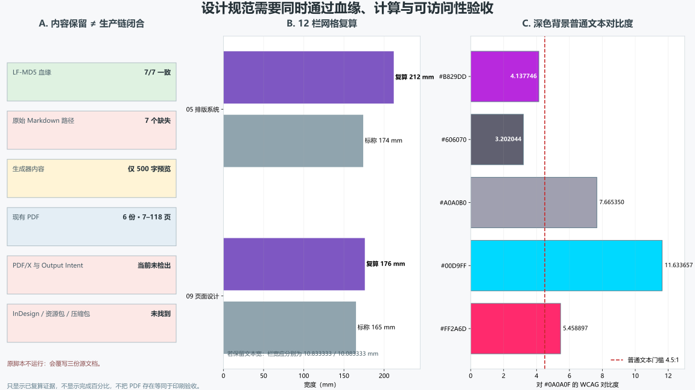

# 杂志设计系统：科学传播、计算一致性与生产溯源审计

> 2026-11-10。11 份文档只读；不运行原生成器，不修改原文，不把 PDF 存在当作科学或印刷验证。

## 一、总裁决与四个方向

11 份文档共同构成科学传播与制作纲领，不是 11 个新理论；新增的是公众传播与证据治理方向。

| 方向 | 已闭合的局部审计 | 未竟工作与下一步 |
|:--|:--|:--|
| `editorial_evidence`：面向公众的科学传播、引文与证据等级治理 | 必然性、实验、H₂S 单位、99% 能效、绝对安全和引文风险已定位。 | 其余历史、价格、引文和案例未逐项回源，编辑证据卡尚未形成。 **下一步：**建立逐句来源—证据等级—允许措辞表，模拟内容明确标记，校验图标不得替代验证。 |
| `computational_design`：把网格、开本、页数、色彩和版本变成可复算设计合同 | 两套网格、页数冲突和两项对比度失败已复算。 | DPI、色彩转换、版本页数和唯一设计令牌尚未统一。 **下一步：**先确定版本清单与物理单位，再由脚本生成和检查设计令牌，禁止手工互相照抄。 |
| `accessible_media`：网页、AR、音频和网聊互动的可访问性与真实数据边界 | 普通文本对比度、减弱动效和长按键盘替代缺口已识别。 | 组件未实现，键盘／读屏／减弱动效和真实互动数据未验收。 **下一步：**以最小网页切片验证键盘等效操作、减弱动效、焦点、对比度和模拟数据标签。 |
| `production_provenance`：迁移、生成器、PDF、模板、权利和印前交付溯源 | 七项 LF-MD5 血缘、六份 PDF、模板／资源包／压缩包缺口和生成器风险已核清。 | 完整生成链、PDF/X、字体与图像权利、压缩包和印前签字未闭合。 **下一步：**改为只读输入、明确输出目录和失败非零退出，再建立资产哈希与印前验收清单。 |

## 二、来源与资产血缘

| 来源 | 只读路径 | SHA-256 |
|:--|:--|:--|
| `magazine_readme` | `toe-sylva-audit/papers/room_temp_sc/organized/11-杂志设计/01-杂志说明.md` | `8462664575ea8c2be26f87edb185bd92ad5bd79ed05edc4d9b83a86508f46920` |
| `magazine_intro` | `toe-sylva-audit/papers/room_temp_sc/organized/11-杂志设计/02-杂志简介.md` | `7137a7552f2eefd97eee3681da904a35d4bffcb68af12c0e063620f6106f2b3d` |
| `pixel_system` | `toe-sylva-audit/papers/room_temp_sc/organized/11-杂志设计/03-黑白像素系统.md` | `2b05baac70fe8d8760df027d2d625f2801c5c0e947ece6beb3de93a4defe31b2` |
| `vi_design` | `toe-sylva-audit/papers/room_temp_sc/organized/11-杂志设计/04-VI设计.md` | `a7508aeda44598c028c200c0b3bdd1f30807f652c9cc26c88b9171dbefe52826` |
| `layout_system` | `toe-sylva-audit/papers/room_temp_sc/organized/11-杂志设计/05-排版系统.md` | `4602f8893cf31707858ff373c76068d2f080283599cc5894f2ee741d332089f8` |
| `content_architecture` | `toe-sylva-audit/papers/room_temp_sc/organized/11-杂志设计/06-内容架构.md` | `97cfb31cdb3269f3645f5f953b418d001139137eadfae2f562aa37d61db3670a` |
| `web_layout` | `toe-sylva-audit/papers/room_temp_sc/organized/11-杂志设计/07-网页风格排版.md` | `6c1d2e6d183b63d62a8a7355180f3c6fcbf6711da81a189ae959fe8430c943c4` |
| `chat_culture` | `toe-sylva-audit/papers/room_temp_sc/organized/11-杂志设计/08-网聊文化融入.md` | `fe0dbae3b98307a02b32a286055657e7ecb604f31d621e579789880fe6746a7b` |
| `page_designs` | `toe-sylva-audit/papers/room_temp_sc/organized/11-杂志设计/09-页面设计.md` | `740e6d85ceb025e263f62d1772c8c60270836a39d595c07bf7e696ac71400036` |
| `print_guide` | `toe-sylva-audit/papers/room_temp_sc/organized/11-杂志设计/10-印刷指南.md` | `d7ea6c943ea3c33ed16c4d41cbda3e8e5caed48573a3f4104aa8d0a09571ef72` |
| `design_notes` | `toe-sylva-audit/papers/room_temp_sc/organized/11-杂志设计/11-设计笔记.md` | `71780e9bce7b365779a7b462091d405100f17508da378d3cb020dc0cc8cc2221` |
| `generator` | `toe-sylva-audit/papers/room_temp_sc/magazine/generate_pdf.py` | `0d1a07296af61de49ed651f6210e237e561da6e77f9859c5795d3d56a778460c` |
| `delivery_report` | `toe-sylva-audit/papers/room_temp_sc/magazine/DELIVERY_REPORT.md` | `95bb50a5188edc8ac904bf5e7c057212d8606a711592222103ccd904ca82c10f` |
| `file_index` | `toe-sylva-audit/papers/room_temp_sc/magazine/file_index.json` | `8dab54d9cb830f649eed67574fba3fc7c22d85b309f274cfa852d46e8d43d3da` |
| `checksums` | `toe-sylva-audit/papers/room_temp_sc/magazine/checksums.md5` | `b5e402be6adc80031d48994d4b80b6e81ea9b26d73435e791c257517e72e0b69` |
| `handbook_review` | `handbook-chapters/review.json` | `0394b996c271a6ca24b4692d7bd078b4c0fa8925eefde6df0347a478f298ac48` |
| `technical_review` | `technical-docs/review.json` | `d27fca5597387c24e9d0038e971055566522441a1f1f1dd8a0dd7dfe662e305f` |

七份设计文档的 LF 归一化 MD5 与原始清单 **7/7 一致**；七个原始路径缺失不代表内容丢失。六份 PDF 存在，但压缩包、InDesign 模板和 VI 资源包未找到。

| PDF | 当前页数 |
|:--|--:|
| `Sylva_Magazine_Complete.pdf` | 108 |
| `Sylva_Magazine_Full.pdf` | 22 |
| `Sylva_Magazine_RoomTempSC.pdf` | 15 |
| `Sylva_Magazine_Volume1.pdf` | 118 |
| `Sylva_Magazine_Volume2.pdf` | 21 |
| `Sylva_Magazine_Volume3.pdf` | 7 |

六份 PDF 首页均为 A4；当前未检出 Output Intent 或 PDF/X 标记。原脚本只读取每份文档前 500 字符，并会覆写三份说明文档，故未运行。

**图件插入顺序：图 1 位于资产与血缘表之后、逐文档裁决之前。**

## 三、11 份文档逐篇裁决

| 文档 | 方向 | 角色 | 未竟工作与下一步 |
|:--|:--|:--|:--|
| 01-杂志说明 | `computational_design`、`production_provenance` | 设计系统入口与快速开始 | 七项原路径缺失，规格与其他文档不一致。 **下一步：**让入口指向真实资产，区分设计手册、预览 PDF 和完整杂志。 |
| 02-杂志简介 | `editorial_evidence`、`computational_design` | 首刊公众叙事与规格摘要 | 数学必然、13 次实验、6% 和 106 页缺乏当前验收。 **下一步：**按既有科学审计降级措辞，并建立期号—版本—页数清单。 |
| 03-黑白像素系统 | `computational_design`、`production_provenance` | 黑白像素与印刷工艺方案 | 8px／8mm、A4／256×192mm 和字体／互动资产未统一。 **下一步：**定义 DPI 与物理尺寸，提供可验证字体、图像和交互资源。 |
| 04-VI设计 | `computational_design`、`accessible_media`、`production_provenance` | 品牌视觉识别与跨媒介令牌 | 色值、Pantone、断点、资源链接和联系方式未统一或核实。 **下一步：**冻结唯一令牌来源，核验资源包、域名与使用授权。 |
| 05-排版系统 | `editorial_evidence`、`computational_design`、`production_provenance` | 印刷级网格、图表与工艺规范 | 12 栏网格算不通，99% 能效和完成标记越界。 **下一步：**修正几何和示例，完成印前检查前删除生产完成语义。 |
| 06-内容架构 | `editorial_evidence`、`computational_design`、`production_provenance` | 栏目、内容分配与编辑流程 | READY_FOR_PRODUCTION 与未核实新闻、案例、页数矛盾并存。 **下一步：**完成事实核查和真实采访，统一页数后再审议生产状态。 |
| 07-网页风格排版 | `accessible_media`、`computational_design` | 响应式网页与数字阅读增强 | 两项色值不满足普通文本对比度，动效和组件未做可访问验收。 **下一步：**加入减弱动效、键盘路径和自动对比度测试，再实现组件。 |
| 08-网聊文化融入 | `editorial_evidence`、`accessible_media` | 网聊语言、引用与互动编辑规范 | 引文、绝对安全、坍缩解释和模拟互动数据缺少边界。 **下一步：**区分直接引语／释义／虚构示例，提供非手势等效操作。 |
| 09-页面设计 | `editorial_evidence`、`computational_design`、`production_provenance` | 页面模板、数据表和输出规范 | H₂S 单位归类、栏宽、引文、图片权利和占位 ISBN 未闭合。 **下一步：**先修科学表格和网格，再核验模板、引文与出版信息。 |
| 10-印刷指南 | `production_provenance`、`computational_design` | 纸张、成本、供应商和验收建议 | 价格、供应商、PDF/X 与实际 PDF 未形成当前验收链。 **下一步：**保留为询价与打样指南，标注日期并获取真实报价和印前报告。 |
| 11-设计笔记 | `editorial_evidence`、`accessible_media` | 品牌理念与跨媒介设计哲学 | SEO、深色护眼和社群设想仍是主张或愿景。 **下一步：**把价值主张与可测假设分开，以读者研究验证可读性。 |

## 四、可计算设计与科学传播

- 05 网格：12×14＋11×4＝**212 mm**，不是 174 mm；174 mm 文本宽对应栏宽约 **10.833333 mm**。
- 09 网格：12×11＋11×4＝**176 mm**，不是 165 mm；165 mm 文本宽对应栏宽约 **10.083333 mm**。
- 页数：简介 106 页、架构 60 页；封面故事分配 14 页，细项却为 16 页。现有 PDF 为 7–118 页，必须建立版本清单。
- 对比度：霓虹紫约 **4.137746**、弱化灰约 **3.202044**，均低于普通文本 4.5:1。
- 科学传播：McMillan 严格证明／数学必然、13 次实验与 6%、H₂S 的 GPa 列入临界磁场、99% 能效和量子通信绝对安全均不能直接发布为已验证事实。

## 五、十二项分级勘误

| 级别 | 已观察问题 | 建议动作 |
|:--|:--|:--|
| P0 | 02 将简化 McMillan 公式写成严格证明和数学必然。 | 按手册审计改为指定模型与参数域内的条件性估算，删除普遍必然性。 |
| P0 | 02 复述 13 次实验和仅 6% 误差，容易升级为独立验证。 | 并列作者预印本、理论预测和独立复现状态，不写完美实验验证。 |
| P0 | 09 把 H₂S 的 155 GPa 放在临界磁场列。 | 将 155 GPa 移至压力列并补充来源；磁场另列、注明温度条件，不混用单位。 |
| P0 | 06 标 READY_FOR_PRODUCTION，但科学、资产和版本验收未闭合。 | 状态退回草案，设置科学、设计、无障碍和印前四道独立验收门。 |
| P1 | 05／09 两套 12 栏计算分别为 212／176mm，与标称 174／165mm 不符。 | 采用由文本宽反算的 10.833333／10.083333mm 栏宽，或重定文本宽并统一全库。 |
| P1 | 106／60／96／48–64 页和多种开本并存，现有 PDF 又为 7–118 页。 | 建立期号、媒介、版本、页数、生成器和哈希的唯一清单，禁止相互冒充。 |
| P1 | 生成器原路径七项缺失，只生成 500 字预览且覆写三份源文档。 | 不运行原脚本；重构为只读输入、独立输出、完整内容和失败非零退出。 |
| P1 | 霓虹紫／弱化灰对比度低于 4.5，未指定减弱动效和长按键盘替代。 | 调整普通文本色并验证键盘、焦点、读屏和 prefers-reduced-motion。 |
| P1 | 直接引语、99% 能效、MRI 比例、无限续航和绝对安全等缺少来源或限定。 | 逐项回源并标注释义／示例；不能回源则删除或降级，不凭风格保留科学断言。 |
| P1 | 模板、图像权利、字体授权、占位 ISBN、域名和联系方式未核实。 | 发布前建立授权与占位清除清单，示例 ISBN 不得进入正式版权页。 |
| P2 | 点赞、阅读、访谈和田野调查模板可能被误读为真实数据。 | 显著标注模拟数据；真实报道需采访记录、同意与可追溯材料。 |
| P2 | CMYK、Pantone、灰阶和断点在不同文档中不一致。 | 以 ICC／打样和统一令牌为准，不把多套屏幕近似值当作已校准印刷色。 |

## 六、验证范围与开放边界

| 边界 | 状态 |
|:--|:--|
| `scientific_claims_verified` | `false` |
| `production_ready` | `false` |
| `pdf_print_verified` | `false` |
| `web_accessibility_verified` | `false` |
| `archive_verified` | `false` |
| `full_repository_audit` | `false` |

本批使用 17 项冻结来源、七项 LF-MD5 血缘、六份 PDF 只读元数据和独立复算。命令与退出码见 `run.log`；Word 验收见 `word-qa/report.json`。

未逐项回源的历史、价格、引文与案例仍标未核实。本批没有生成新印刷 PDF，没有进行 PDF/X 认证或实验验证，没有修改 11 份原文。**全库审计尚未完成。**
