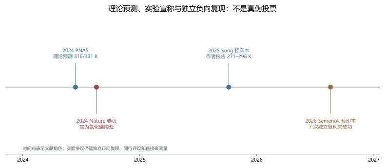

# 主论文四版本与手册两章：证据角色、实验争议与未竟工作审计

> 日期：2026-11-10。只审计，不修改六份原文。预印本存在、作者报告、独立复现、同行评议和数学证明分别记录。

## 一、总裁决

当前不是“只有理论预测”，也不是“实验已经铁证完成”，而是**正向实验预印本与独立负向复现并存**。Song 的实验报告必须保留，Semenok 的负向结果同样必须保留；独立正向复现和同行评议尚未确立。

四份主论文版本和两章手册属于同一研究纲领，不是六个新理论。本批形成必然性命题、可复现计算、实验争议和出版治理四个方法方向。

| 来源 ID | 只读路径 | SHA-256 |
|:--|:--|:--|
| `main_master` | `toe-sylva-audit/papers/room_temp_sc/organized/02-主论文/01-主论文.md` | `862e3232520ee961bc307a8e97cfd0b32a869a97197b159281596be3437d227f` |
| `nature_version` | `toe-sylva-audit/papers/room_temp_sc/organized/02-主论文/02-Nature版本.md` | `fc5505cff6e3f65ee080ae4ec7a8f51f8ea2b4404e33a0d59146122bf91c568c` |
| `science_version` | `toe-sylva-audit/papers/room_temp_sc/organized/02-主论文/03-Science版本.md` | `598de079d503596b9c9a5d43ba5027fafc5d9a13a12c4b3b03a3ba3e36d2e809` |
| `arxiv_version` | `toe-sylva-audit/papers/room_temp_sc/organized/02-主论文/04-arXiv版本.md` | `7893cc30f25baca9aef27a3a3f9fc1a232e86fafdde109753885487f9268fc3b` |
| `handbook_materials` | `toe-sylva-audit/papers/room_temp_sc/organized/08-手册章节/03-第4-5章_材料与实验.md` | `2816948242751325c7d3d28995f1ce836fb064e426f7d2bc941df3b14c8d5acd` |
| `handbook_future` | `toe-sylva-audit/papers/room_temp_sc/organized/08-手册章节/04-第6章_未来展望.md` | `43e7826fac1fd4260e1cf0c01bf2ba6c1ffd6616652bb9b8825ea4fa006443bd` |
| `critical_results` | `.worktrees/critical-manifold/papers/room_temp_sc/critical_manifold/results.json` | `f9438c770c1125c68b42a67778458d551f3694d1954b112bdf61d6942bac970b` |
| `prior_methods_review` | `research/paper-direction-audit-2026-11-10/room-temp-methods/review.json` | `cc73b74ad9951d6b0d25dee50ac06babd8f8ea2ffdde8a4823923d506cc466f7` |
| `song_pdf` | `sources/song-2510.01273.pdf` | `b820d4dac9162c0f8b914282afbbbe85e7005bce68c7b217abff070a715debdf` |
| `semenok_pdf` | `sources/semenok-2605.29985.pdf` | `a1dc4c13ecf800baf422e97aa51ba004b85ec7e6e32ecc7bf9f850df39a09bef` |

## 二、四个方法方向

| 方向 | 已闭合的局部审计 | 未竟工作与下一步 |
|:--|:--|:--|
| `necessity_proof`：简化公式、严格数学界与必然性措辞的边界研究 | 三组数值反例与证明债务已定位，普遍必然性不能按现稿成立。 | 完整命题、假设、严格下界、Lean 命题类型和证明体均未闭合。**下一步：**先收缩标题与摘要，再建立可检验的充分条件或条件化命题。 |
| `reproducible_computation`：材料计算与 SI 可复现基础设施 | SI 仍是模板，主论文中的 DFT 完成式措辞没有对应资产。 | 结构、输入、赝势、k/q/截断能收敛、声子和 Eliashberg 输出。**下一步：**先做一个材料的垂直复现切片，再恢复计算验证章节。 |
| `experimental_controversy`：LaSc₂H₂₄ 的正向实验报告与独立负向复现研究 | Song 与 Semenok 预印本均存在，证据角色和相反结果已核清。 | 独立正向复现、同行评议、直接 Meissner、前驱体有序化和同位素验证。**下一步：**并列保存两组原始数据，优先解决前驱体和跨实验室复现。 |
| `publication_governance`：版本、引文、叙事和证据等级治理 | Nature 卷页错配已确认；成功率、日期和终极证明措辞已分档。 | 六份原文修订、勘误留痕、未核实叙事处理和版本同步。**下一步：**先修 P0 引文和证明措辞，再同步 P1 时间线与证据卡。 |

## 三、LaSc₂H₂₄：证据时间线与争议结构

| 来源 | 文献角色 | 关键结果 | 不能升级为 |
|:--|:--|:--|:--|
| PNAS 121(26) | 2024 理论预测 | 167 GPa 最高 316 K；250 GPa 最高 331 K | 实验确认或后续实验的替代品 |
| Song，arXiv:2510.01273 | 2025 正向实验预印本 | 作者报告 271–298 K／195–266 GPa；13 次可重复运行 | 独立正向复现、同行评议、直接 Meissner 或必然性证明 |
| Semenok，arXiv:2605.29985 | 2026 独立负向复现预印本 | 7 次合成未成功；250–280 GPa 下未见 245–300 K 超导 | 对 Song 或整个材料族的最终逻辑否证 |

**图件插入顺序：图 1 位于证据比较表之后、争议解释之前。** 图中时间点表示文献角色，不是真伪投票，也不表示社区共识。

Song 原文报告零电阻、磁场抑制和 XRD，并把高于 200 GPa 的直接 Meissner 磁测量列为后续工作。Semenok 原文报告七次未成功，同时仍讨论 300 GPa 下理论 Tc>300 K 和前驱体工程。两者并不支持简单投票式结论；下一步应核对前驱体有序化、原始数据和跨实验室正向复现。

来源：[PNAS](https://www.pnas.org/doi/10.1073/pnas.2401840121)、[Song](https://arxiv.org/abs/2510.01273)、[Semenok](https://arxiv.org/abs/2605.29985)。

## 四、Nature 引文错配：这是确定错误

手册 [C1] 把 Nature 626, 779–784 写成 `Superconductivity above 320 K in lanthanum-scandium polyhydride at megabar pressures`。Crossref 的权威元数据表明该卷页实际是 **Twisted-layer boron nitride ceramic with high deformability and strength**，DOI `10.1038/s41586-024-07036-5`，主题是氮化硼陶瓷，**不是 2024 年 Nature 论文**所声称的 LaSc₂H₂₄ 工作。

后续原文修订应删除该错误引文并留痕，分别引用 PNAS 预测、Song 正向预印本和 Semenok 负向预印本。不得把 Song 的 2025 预印本倒填成 2024 Nature 论文，也不得写成已有独立实验室交叉验证。

核验：[Crossref 元数据](https://api.crossref.org/works/10.1038/s41586-024-07036-5)。

## 五、必然性命题：数值反例和证明债务

临界流形使用同一简化 Allen–Dynes/McMillan 公式且 f₁=f₂=1：

$$T_c^{\mathrm{simple}}=\frac{11.6\,\omega_{\log}}{1.20}\exp(-E).$$

| λ | μ* | 输入 ωlog（meV） | Tc（K） |
|---:|---:|---:|---:|
| 2.0 | 0.15 | 100.0 | 148.24313461676417 |
| 2.0 | 0.1 | 100.0 | 166.85029454929392 |
| 2.5 | 0.1 | 140.0 | 267.4533390338644 |

三个锚点均低于 300 K。全量复核为 936 组根、38,376 个直接点，分类不一致为 0。这反驳的是使用同一简化公式时的普适必然性措辞，**不否定完整 Eliashberg 理论、特定材料或 Song 的实验报告**。

前批方法审计还记录 Lean Markdown 48 处行首证明债务、独立文件 3 个显式 sorry，未运行编译；SI 有 31 处既定模式占位，未提供 DFT 输入、声子谱或收敛日志。主论文的“形式证明”“完整 DFT 验证”不能按现稿成立。

## 六、手册叙事：哪些可以说，哪些不能说

- **可以说**：Song 作者报告 13 次可重复实验运行、零电阻、磁场抑制和 XRD。
- **必须同时说**：Semenok 等报告七次未成功，独立正向复现与同行评议未确立，直接 Meissner 仍是待办。
- **成功率 100% 不受支持**：13 次可重复运行没有提供总尝试分母，不能改写为“13 次全部成功”。
- **未核实而非判假**：第 42/43 次故事、300 万元成本等在当前全文的针对性检索中未找到支持，标记未核实或删除并留痕。
- **不能写**：“铁证”“独立实验室交叉验证”“必然性的终极证明”“2024 年 Nature 320 K 突破”。

## 七、前批审计补充

保留前批 PNAS 预测角色；补充正负实验预印本，不再将总体状态简写为只有预测。这是一项时间边界补充，不是删除前批结果，也不意味着 PNAS 数值判断错误。

## 八、分档勘误与后续优先级

| 级别 | 对象 | 已观察问题 | 建议动作 |
|:--|:--|:--|:--|
| P0 | handbook_future [C1] | Nature 626, 779–784 被错配为 LaSc₂H₂₄ 论文。 | 删除错误引文并留痕，改引 PNAS、Song、Semenok 各自真实身份。 |
| P0 | 四份主论文标题、摘要、证明和结论 | 形式证明／严格验证措辞与证明占位、SI 模板及数值反例不相容。 | 降级为条件化研究框架；完成命题与反例处置前不得恢复必然性措辞。 |
| P0 | handbook_materials 5.5–5.6、本章小结 | 成功率 100%、铁证、独立确认和终极证明超出当前证据。 | 改为作者报告 13 次可重复运行，同时披露独立负向复现与未决问题。 |
| P1 | handbook_future 结语、术语和核心文献 | 2024 年 320 K 实验叙述混淆 PNAS 预测与 Song 2025 预印本。 | 分开 2024 预测与 2025 报告，不倒填 Nature 或同行评议状态。 |
| P1 | handbook_materials 证据链与未公开故事 | 直接 Meissner 未完成；成本与第 42/43 次故事未核实。 | 直接磁测量列为待办；叙事标未核实或删除并留痕，不判虚构。 |
| P1 | room-temp-methods 前批范围外登记 | 前批未纳入 Song 与 Semenok，不能继续简写为只有预测。 | 保留 PNAS 判断，补充正负预印本及本批链接。 |

P2 的实质研究任务包括：一个材料的完整计算复现切片、Lean 命题和证明清偿、前驱体有序化对照、独立正向复现、直接 Meissner 和同位素验证。书目纠错本身不等于科学突破。

## 九、验证范围

本批使用冻结哈希、原始 PDF、Crossref 元数据、前批方法审计和临界流形数值证据。独立来源复核见 `verify_primary_sources.py`；最终命令、退出码见 `run.log`；Word 逐页结果见 `word-qa/report.json`。

本批没有运行 Lean、没有新做实验或独立复现、没有新增材料预测，也没有修改六份原文。**全库审计尚未完成。**
