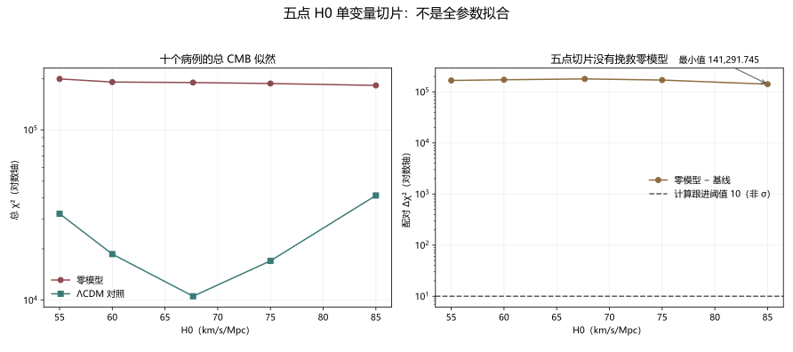

# 物理直觉两份文档：方向、血缘与未竟工作审计

> 日期：2026-11-10。范围：两份 integrated research report 及其冻结数值证据。本文不修改提供方工作树，不重跑全参数空间，不把局部 profile 写成宇宙学后验。

## 一、来源与血缘裁决

两份文档属于**同一研究纲领**，合订本不是独立新理论。以下哈希在生成时重新计算并与清单一致：

- `physical-intuition:research/physical-intuition/MATH_PHYSICS_WORLDVIEW_2026.md`：`89fc5499acd3f5afd05ffd0b4eacae3f40d33822802679a3c105d34acc0f9eb4`（只读）。
- `physical-intuition:research/physical-intuition/TOTAL_PROJECT_2026-11-08/TOTAL_REPORT.md`：`91f6653c273c3783e9fc71ef8b9b64463a038fecd5763633038e601d93ae862d`（只读）。

主文档当前含未提交修改，审计只读其当前内容；提供方的其他修改保持原状。36 节不机械拆成 36 个方向，而归为四个候选问题族。

## 二、四个候选问题族

| 问题族 | 当前角色 | 已闭合的局部工作 | 未竟工作与下一步 |
|------|------|------|------|
| math_physics_methodology | 项目内独立的方法论方向，不是外部新的统一物理理论 | 真理、模型与数据分轨；类型化层级、结构卡和可否证流程已有书面框架。 | 结构卡覆盖、冻结后评估、跨问题族迁移、常规基线对照与成本审计。下一步：以未见任务和统一成本面板检验结构卡的实际增益。 |
| zero_cdm_observation | 明确联合模型的可证伪研究方向，与总报告同一血缘 | 固定输入零模型被 Planck 透镜和完整 CMB 强烈排除；五点 H0 切片没有挽救；BBN 不能抵消 CMB 排除。 | 非线性、完整参数空间、独立 Boltzmann 实现、更多数据联合、真实物质部门与替代模型。下一步：把固定点负向结果与全参数后验、非线性和其他无 CDM 机制分开推进。 |
| crosscode_systematics | 可独立发展的跨代码与数值验证基础设施方向 | TT 透镜口径、若干插值与共动映射错误已纠正；k800 输出加密被证明无收益。 | 极端相位与深谷未收敛，复合实现差异仍在；AccuracyBoost=8 多次触及 300 秒前台时限且无结果。下一步：以单变量精度和独立实现研究剩余系统误差，不把 ultra 当最佳估计。 |
| physical_intuition_engine | 候选工程与评价方向，不是已经验证有效的系统 | 混合工作流、双方法评委、任务包和证据卡已有设计。 | 真实引擎实现、未见任务盲测、常规模型对照、消融、许可清单、失败分布和教师依赖评估。下一步：先实现最小引擎，再用隔离数据、消融和常规基线检验相对增益。 |

这些候选方向不自动意味着外部首创，也不表示四条路线均已完成。

## 三、固定零模型的负向证据

固定输入零模型的比较定义为：

$$\Delta\chi^2=\chi^2_{\mathrm{zero}}-\chi^2_{\Lambda\mathrm{CDM}}.$$

Planck 2018 边缘化透镜的三条实现给出 Δχ² 为 1238.705291 至 1238.773762，固定零模型受到强烈排除。完整 CMB 的 HyRec 扩展搜索结果为 Δχ²＝179124.967038，但这里只允许报告已找到并复验的局部 nuisance profile。

### H0 单变量切片

| H0（km/s/Mpc） | 零模型总 χ² | ΛCDM 总 χ² | 零模型−基线 Δχ² |
|---:|---:|---:|---:|
| 55 | 199206.369 | 32188.306 | 167018.063 |
| 60 | 190973.302 | 18632.530 | 172340.772 |
| 67.66 | 189668.604 | 10543.643 | 179124.961 |
| 75 | 187206.691 | 17017.392 | 170189.299 |
| 85 | 182476.365 | 41184.619 | 141291.745 |

**图件插入顺序：图 1 位于五点数据表之后、结果解释之前。** 图 1 与表中数据来自同一 `planck-h0-scan-summary.json`，不是全参数拟合。

最小配对差出现在 H0＝85，为 141291.74549083476。该值仍远高于计算跟进阈值 10，未触发扩展扫描；阈值不是 p 值或 σ 显著性。

BBN 的三组观测选择中，零模型与基线的最大绝对 Δχ² 仅为 0.004415687278，近似一致，不能抵消 CMB 排除。

**边界：以上结果不是整个无 CDM 模型族的排除，也不是全参数后验或全局最优证明。**

## 四、跨代码系统误差：哪些闭合，哪些没有

TT 透镜口径、若干插值与共动映射错误已经纠正；k800 与 ultra 的全部 5878 个共享 q 节点和共动密度逐位一致，最高带对数变化为 0，说明输出加密没有求解精度收益。AccuracyBoost=8 多次触及 300 秒前台时限且没有数值结果，不能写成已完成。

极端相位序列、深谷点值、复合实现差异和非线性仍未闭合。相邻精度稳定、规范修正或单变量零差异不能升级为全谱、观测或跨代码闭合。

## 五、物理直觉工程化尚未验收

**物理直觉引擎尚未验证有效。** 当前只有混合工作流、双方法评委、任务包和证据卡设计，不能据此证明程序存在、模型有效或跨领域直觉可靠。下一步必须先实现最小引擎，再使用未见任务、常规模型对照、消融、许可清单和失败分布评估相对增益。

数学—物理观与 AI 研究治理同样需要以实际任务覆盖、成本面板和冻结后评估检验，不能将结构化文档等同于已完成的制度。

## 六、验证命令与范围

基线测试：

`python -m unittest discover -s "C:/Users/一梦/Documents/kimi/workspace/.worktrees/provider-main-integration/research/physical-intuition/zero-cdm/tests" -p "test*.py" -v`

实际为 41/41 通过。审计合同运行 `python test_physical_intuition_audit.py -v`；Word 使用 `docx.py build`／`validate` 与 doc-k 最终视图逐页验收，命令和退出码见 `run.log` 与 `word-qa/report.json`。

本审计只覆盖这两份文档，不代表全库审计完成，也不替代非线性、全参数、独立实现和物理直觉引擎的后续验证。
