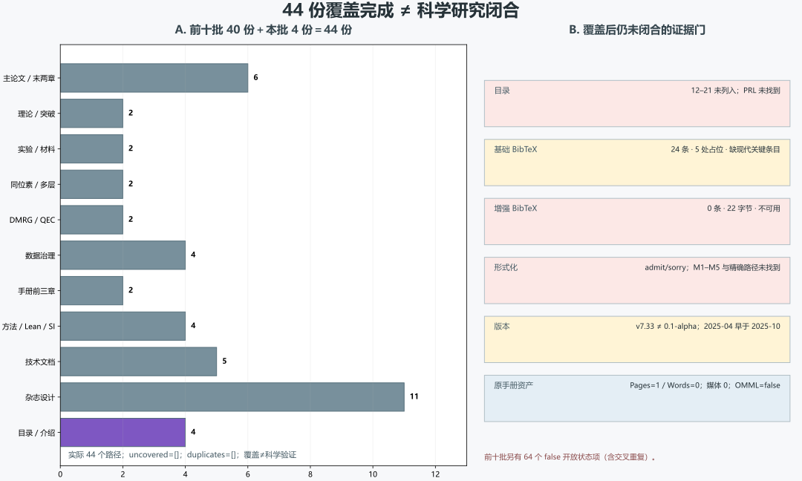

# 目录、项目介绍与 44 份文档覆盖图审计

> 2026-11-10。只读审计，不修改原文。**覆盖完成不等于研究闭合。**

## 一、覆盖裁决与四个方向

4 份文档分别承担导航、形式化草案、手册与公众策划，不独立构成新理论；44 份覆盖完成不等于研究闭合。

实际 44 个 Markdown 路径：前十批 40 份，本批 4 份，即 **40＋4＝44／44**；`uncovered=[]`，`duplicates=[]`。

| 方向 | 已闭合的局部审计 | 未竟工作与下一步 |
|:--|:--|:--|
| `coverage_governance`：目录、证据导航、批次血缘与 44 份覆盖图 | 前十批 40 份与本批 4 份已逐路径核对，遗漏和重复均为空。 | 原目录遗漏 12–21、PRL 和不可用链接尚未在原目录修复。 **下一步：**以机器生成的覆盖图作为导航事实源，记录批次、共享方向、哈希和开放状态。 |
| `conditional_formalization`：把必然性草案拆成假设、定义、证明债务和编译验收 | admit/sorry、M1–M5 待实现、精确路径缺失和不会报错措辞已定位。 | 定义、M1–M5、证明、编译、数值案例和物理映射均未闭合。 **下一步：**保留 0.1-alpha 草案级，先定义最小命题并真实编译；禁止以 sorry 换取不会报错。 |
| `handbook_reference_governance`：手册版本、日期、资产元数据和参考文献可用性 | 版本分歧、时间矛盾、24／0 条文献和原手册元数据已核清。 | 手册视觉、文献补齐、现代关键条目、版本血缘和引用验收未完成。 **下一步：**冻结版本清单，修复时间线，补齐并校验 BibTeX，再验收页数、图件与公式。 |
| `public_communication`：杂志策划、公众预期和科学传播边界 | 策划的栏目、视觉与互动方向已保留，科学措辞和媒介边界已连接前批审计。 | 首刊标题、真实内容、互动可访问性和实际发布物未验收。 **下一步：**以条件性科学表述制作样章，模拟互动明确标记，不把策划案当理论或成品。 |

## 二、批次覆盖与证据图

| 批次 | 覆盖数 | 前批 false 开放状态项（含重叠） |
|:--|--:|--:|
| `main-claims` | 6 | 9 |
| `theory-breakthrough` | 2 | 6 |
| `validation-materials` | 2 | 6 |
| `isotope-dft` | 2 | 6 |
| `dmrg-qec` | 2 | 6 |
| `data-governance` | 4 | 7 |
| `handbook-chapters` | 2 | 6 |
| `room-temp-methods` | 4 | 6 |
| `technical-docs` | 5 | 6 |
| `magazine-design` | 11 | 6 |
| `project-intro` | 4 | 本批 |

前十批共有 64 个 false 开放状态项，彼此可能重叠，不能解释为 64 个独立科学任务。

**图件插入顺序：图 1 位于覆盖总览表之后、4 份文档逐篇裁决之前。**

## 三、4 份文档逐篇裁决

| 文档 | 方向 | 角色 | 未竟工作与下一步 |
|:--|:--|:--|:--|
| 00-目录索引 | `coverage_governance` | 项目导航与推荐阅读路线 | 遗漏 12–21，PRL 和不可用增强文献／Lean 路线未修正。 **下一步：**由覆盖图生成真实目录，并为每条路线附证据状态和未竟工作。 |
| 01-项目说明 | `conditional_formalization` | 0.1-alpha 必然性形式化草案 | H1–H6、M1–M5、证明、编译和版本血缘未闭合，且有不会报错措辞。 **下一步：**删除编译保证，建立最小可编译命题和证明债务清单。 |
| 02-手册说明 | `handbook_reference_governance` | 手册结构、读者与参考文献入口 | 2025-04 早于 2025-10 内容，完美实验叙事和资产元数据未验收。 **下一步：**核对版本时间，按证据等级改写并修复文献和原手册验收。 |
| 03-杂志简介 | `public_communication` | 科技人文杂志策划任务书 | 首刊标题、真实内容、AR／长按和发布资产仍是策划或愿景。 **下一步：**保留创意，使用条件性标题并制作可访问样章，不称新物理理论。 |

## 四、目录、形式化、手册与文献证据

- 目录遗漏 12–21；PRL 未找到。增强文献虽被推荐，但当前文件只有 22 字节、**0 条** BibTeX。
- 基础文献有 **24 条** BibTeX 和 5 处占位，未找到 `2510.01273`、`2605.29985`、`2401840121`。
- 项目说明包含 admit/sorry 和“不会报错”；理论文档、所称 Lean 和 M1–M5 精确路径未找到。
- 原 README 为 v7.33，组织后项目说明为 0.1-alpha，两者不是同一版本。
- 手册说明的 2025 年 4 月早于其中 2025 年 10 月内容；只标版本时间矛盾。
- 原手册 DOCX 存在，但应用元数据 Pages=1、Words=0，媒体=0、OMML=false；约 50 页未据此验证。

## 五、十二项分级勘误

| 级别 | 已观察问题 | 建议动作 |
|:--|:--|:--|
| P1 | 目录只列 01–11，遗漏 12–21 的资料收集与技术复盘。 | 以 44 份覆盖图补齐真实目录，保留原目录版本和修改留痕。 |
| P1 | 目录写主论文加 Nature／Science／arXiv／PRL 四版本，但 PRL 未找到。 | 改为当前实际版本清单，PRL 标未竟或缺失，不写已存在。 |
| P0 | 项目说明以严格数学框架和必然性为主线，但证明与物理映射未闭合。 | 保持探索性假说和条件命题，标题与摘要不得超过证明状态。 |
| P1 | 理论文档、所称 Lean 与 M1–M5 精确路径未找到。 | 建立真实模块索引；未找到路径不得作为可编译或已交付证据。 |
| P0 | 项目说明同时承认 admit/sorry 并声称使用它们确保不会报错。 | 删除保证；以真实编译命令、退出码和证明债务报告替代。 |
| P1 | 原 README 为 v7.33，组织后项目说明为 0.1-alpha，内容并不相同。 | 分开版本血缘，不把 v7.33 的较审慎声明自动回填到旧草案。 |
| P1 | 手册说明标 2025 年 4 月更新，却包含 2025 年 10 月突破。 | 核对实际生成和修改时间，只标元数据矛盾，不判造假。 |
| P1 | 原手册 DOCX 存在，但 Pages=1、Words=0、媒体=0、OMML=false。 | 不以文件大小推断约 50 页或图文并茂；重新渲染并检查页数、图件和公式。 |
| P1 | 基础文献有 24 条和 5 处占位，缺少 Song、Semenok 与 PNAS 关键标识。 | 补全并校验条目、DOI／arXiv、证据角色和撤回状态，不能只增加数量。 |
| P0 | 目录推荐的增强文献文件仅 22 字节、0 条 BibTeX。 | 从推荐阅读移除直至生成可解析文献库；文件存在不等于可用。 |
| P0 | 手册说明使用完美对应、历史实现和 13 次从偶然到必然的叙事。 | 按 Song／Semenok／PNAS 的证据角色改写，保留独立复现与直接磁测量待办。 |
| P2 | 杂志首刊标题和互动策划可能提前放大科学结论与完成感。 | 标题改为条件性表达，模拟互动标注，提供非手势路径和可访问样章。 |

## 六、44 份文档覆盖清单

共享批次方向不等于单篇独立首创或新理论。

| 文档路径 | 来源 ID | 批次 | 共享方向 |
|:--|:--|:--|:--|
| `00-目录索引.md` | `directory_index` | `project-intro` | `coverage_governance` |
| `01-封面与介绍/01-项目说明.md` | `project_intro` | `project-intro` | `conditional_formalization` |
| `01-封面与介绍/02-手册说明.md` | `handbook_intro` | `project-intro` | `handbook_reference_governance` |
| `01-封面与介绍/03-杂志简介.md` | `magazine_plan` | `project-intro` | `public_communication` |
| `02-主论文/01-主论文.md` | `main_master` | `main-claims` | `necessity_proof`、`reproducible_computation`、`experimental_controversy`、`publication_governance` |
| `02-主论文/02-Nature版本.md` | `nature_version` | `main-claims` | `necessity_proof`、`reproducible_computation`、`experimental_controversy`、`publication_governance` |
| `02-主论文/03-Science版本.md` | `science_version` | `main-claims` | `necessity_proof`、`reproducible_computation`、`experimental_controversy`、`publication_governance` |
| `02-主论文/04-arXiv版本.md` | `arxiv_version` | `main-claims` | `necessity_proof`、`reproducible_computation`、`experimental_controversy`、`publication_governance` |
| `03-理论框架/01-理论框架.md` | `theory_framework` | `theory-breakthrough` | `conditional_proof`、`assumption_falsifiability`、`experimental_controversy`、`provenance_governance` |
| `04-材料预测/01-材料预测.md` | `material_predictions` | `validation-materials` | `formula_evidence`、`sample_doping`、`higher_order_hydride`、`validation_governance` |
| `05-实验验证/01-实验验证.md` | `validation_report` | `validation-materials` | `formula_evidence`、`sample_doping`、`higher_order_hydride`、`validation_governance` |
| `06-突破详解/01-2025年10月突破.md` | `breakthrough_report` | `theory-breakthrough` | `conditional_proof`、`assumption_falsifiability`、`experimental_controversy`、`provenance_governance` |
| `07-形式化代码/01-Lean形式化代码.md` | `lean_markdown` | `room-temp-methods` | `floquet_evidence`、`eliashberg_bounds`、`lean_formalization`、`literature_digest`、`reproducible_si` |
| `08-手册章节/01-第1-2章_超导入门与科普.md` | `handbook_intro` | `handbook-chapters` | `pedagogical_physics`、`conditional_model`、`experimental_roles`、`unit_provenance` |
| `08-手册章节/02-第3章_必然性定理.md` | `handbook_theorem` | `handbook-chapters` | `pedagogical_physics`、`conditional_model`、`experimental_roles`、`unit_provenance` |
| `08-手册章节/03-第4-5章_材料与实验.md` | `handbook_materials` | `main-claims` | `necessity_proof`、`reproducible_computation`、`experimental_controversy`、`publication_governance` |
| `08-手册章节/04-第6章_未来展望.md` | `handbook_future` | `main-claims` | `necessity_proof`、`reproducible_computation`、`experimental_controversy`、`publication_governance` |
| `10-技术文档/01-交付摘要.md` | `delivery_summary` | `technical-docs` | `artifact_existence`、`status_evidence`、`scientific_validation`、`delivery_governance` |
| `10-技术文档/02-最终报告.md` | `final_report` | `technical-docs` | `artifact_existence`、`status_evidence`、`scientific_validation`、`delivery_governance` |
| `10-技术文档/03-进度报告.md` | `progress_report` | `technical-docs` | `artifact_existence`、`status_evidence`、`scientific_validation`、`delivery_governance` |
| `10-技术文档/04-质量进展.md` | `quality_progress` | `technical-docs` | `artifact_existence`、`status_evidence`、`scientific_validation`、`delivery_governance` |
| `10-技术文档/05-整合检查清单.md` | `integration_checklist` | `technical-docs` | `artifact_existence`、`status_evidence`、`scientific_validation`、`delivery_governance` |
| `10-技术文档/06-补充信息.md` | `si_template` | `room-temp-methods` | `floquet_evidence`、`eliashberg_bounds`、`lean_formalization`、`literature_digest`、`reproducible_si` |
| `11-杂志设计/01-杂志说明.md` | `magazine_readme` | `magazine-design` | `editorial_evidence`、`computational_design`、`accessible_media`、`production_provenance` |
| `11-杂志设计/02-杂志简介.md` | `magazine_intro` | `magazine-design` | `editorial_evidence`、`computational_design`、`accessible_media`、`production_provenance` |
| `11-杂志设计/03-黑白像素系统.md` | `pixel_system` | `magazine-design` | `editorial_evidence`、`computational_design`、`accessible_media`、`production_provenance` |
| `11-杂志设计/04-VI设计.md` | `vi_design` | `magazine-design` | `editorial_evidence`、`computational_design`、`accessible_media`、`production_provenance` |
| `11-杂志设计/05-排版系统.md` | `layout_system` | `magazine-design` | `editorial_evidence`、`computational_design`、`accessible_media`、`production_provenance` |
| `11-杂志设计/06-内容架构.md` | `content_architecture` | `magazine-design` | `editorial_evidence`、`computational_design`、`accessible_media`、`production_provenance` |
| `11-杂志设计/07-网页风格排版.md` | `web_layout` | `magazine-design` | `editorial_evidence`、`computational_design`、`accessible_media`、`production_provenance` |
| `11-杂志设计/08-网聊文化融入.md` | `chat_culture` | `magazine-design` | `editorial_evidence`、`computational_design`、`accessible_media`、`production_provenance` |
| `11-杂志设计/09-页面设计.md` | `page_designs` | `magazine-design` | `editorial_evidence`、`computational_design`、`accessible_media`、`production_provenance` |
| `11-杂志设计/10-印刷指南.md` | `print_guide` | `magazine-design` | `editorial_evidence`、`computational_design`、`accessible_media`、`production_provenance` |
| `11-杂志设计/11-设计笔记.md` | `design_notes` | `magazine-design` | `editorial_evidence`、`computational_design`、`accessible_media`、`production_provenance` |
| `12-资料收集-氢化物与验证进展.md` | `hydrides_overview` | `data-governance` | `claim_lineage`、`benchmark_scope`、`data_completeness`、`research_update` |
| `13-资料收集-Floquet工程LaH10.md` | `floquet_notes` | `room-temp-methods` | `floquet_evidence`、`eliashberg_bounds`、`lean_formalization`、`literature_digest`、`reproducible_si` |
| `14-资料收集-DMRG-Hubbard模型.md` | `dmrg_notes` | `dmrg-qec` | `dmrg_evidence_ladder`、`extended_model_completion`、`qec_benchmark_roles`、`cross_domain_governance` |
| `15-资料收集-Eliashberg理论边界.md` | `eliashberg_notes` | `room-temp-methods` | `floquet_evidence`、`eliashberg_bounds`、`lean_formalization`、`literature_digest`、`reproducible_si` |
| `16-资料收集-总览与下一步.md` | `batch_overview` | `data-governance` | `claim_lineage`、`benchmark_scope`、`data_completeness`、`research_update` |
| `17-资料收集-同位素效应与压力导数.md` | `isotope_pressure` | `isotope-dft` | `isotope_lineage`、`method_aware_pressure`、`reproducible_dft`、`ml_benchmark_governance` |
| `18-资料收集-量子纠错码进展.md` | `qec_notes` | `dmrg-qec` | `dmrg_evidence_ladder`、`extended_model_completion`、`qec_benchmark_roles`、`cross_domain_governance` |
| `19-资料收集-多层结构DFT参数.md` | `multilayer_dft` | `isotope-dft` | `isotope_lineage`、`method_aware_pressure`、`reproducible_dft`、`ml_benchmark_governance` |
| `20-资料收集-总览与完整清单.md` | `complete_overview` | `data-governance` | `claim_lineage`、`benchmark_scope`、`data_completeness`、`research_update` |
| `21-技术复盘-全领域数据审计.md` | `technical_review` | `data-governance` | `claim_lineage`、`benchmark_scope`、`data_completeness`、`research_update` |

## 七、19 项冻结来源

| 来源 | 只读路径 | SHA-256 |
|:--|:--|:--|
| `directory_index` | `toe-sylva-audit/papers/room_temp_sc/organized/00-目录索引.md` | `633844466f9c1fad0929a5250380a7e0467b7a458c24dc9006d820071dcad317` |
| `project_intro` | `toe-sylva-audit/papers/room_temp_sc/organized/01-封面与介绍/01-项目说明.md` | `ddab8da04e8373fccedacc4634dfee09c7fc4be8eee5064e050f162f6bee4164` |
| `handbook_intro` | `toe-sylva-audit/papers/room_temp_sc/organized/01-封面与介绍/02-手册说明.md` | `dd6721843deed0ad442b5ec3fc53303d4c895b6638d5d3dd5eb8b207b166161a` |
| `magazine_plan` | `toe-sylva-audit/papers/room_temp_sc/organized/01-封面与介绍/03-杂志简介.md` | `7f691b8f56f4d7ff04d4a3b3090cc4b48974fd7da89922ddeb8597bd046c34aa` |
| `base_bib` | `toe-sylva-audit/papers/room_temp_sc/organized/09-参考文献/01-参考文献.bib` | `ca014a4bae5023081149a1c4d051917e7f0540df18241400992c2b2276d43698` |
| `enhanced_bib` | `toe-sylva-audit/papers/room_temp_sc/organized/09-参考文献/02-增强参考文献.bib` | `d4a7d80243bc2fec0b05af4b0c9519d1be86edd0a62cd0d3d82b94a912ab870f` |
| `original_readme` | `toe-sylva-audit/papers/room_temp_sc/README.md` | `8eca2b541eb2412517af4ed28feafb301a29caeac960b6dede08be3717e1b9ff` |
| `handbook_task` | `toe-sylva-audit/papers/room_temp_sc/HANDBOOK_TASK.md` | `e520e11faa500339ceac76c324bddbcae9c6de16908d299fa832cfd7f85edec7` |
| `handbook_docx` | `toe-sylva-audit/papers/room_temp_sc/handbook/room_temp_sc_handbook.docx` | `c2b77fa2b705b634a19f9959015acc990f663ba41d0b116bc6b48a37aa451b50` |
| `main_claims_review` | `main-claims/review.json` | `e9ac6ff0bc88f11b1c2c91ae61ce398a05fc077815803f48669b46536d6f2f45` |
| `theory_review` | `theory-breakthrough/review.json` | `e6acb59a95f4dc159db2692e5db0a6ae40d640f8a8aef04ca1b69da80e3ed8c8` |
| `validation_review` | `validation-materials/review.json` | `17eaa27d30df6849f752e3712d563ebe492ae394ea9c74b1b072ac0755acb491` |
| `isotope_review` | `isotope-dft/review.json` | `e04428ca5980171619ca97bd2cc450fa772074cd9edd73f980905a72b1c2d4b4` |
| `dmrg_review` | `dmrg-qec/review.json` | `367fada5ec9f68011ea50bb437922d140aa7fcb77bbab7517d8548196332a68d` |
| `data_review` | `data-governance/review.json` | `e09aeb77dd254d061d980c306e6762c1ef21ad8a5e826be6a08226d581680aa8` |
| `handbook_review` | `handbook-chapters/review.json` | `0394b996c271a6ca24b4692d7bd078b4c0fa8925eefde6df0347a478f298ac48` |
| `methods_review` | `room-temp-methods/review.json` | `f30d15d8665644d11957166efaea95d59f7a742037dc697b737704cd15dc9e21` |
| `technical_review` | `technical-docs/review.json` | `d27fca5597387c24e9d0038e971055566522441a1f1f1dd8a0dd7dfe662e305f` |
| `magazine_review` | `magazine-design/review.json` | `f025cef1935a604b67fe1c0504d6cdfc377ab2c69db450d3fd2da6034364b3bb` |

## 八、双边界与后续

| 边界 | 状态 |
|:--|:--|
| `organized_44_coverage_complete` | `true` |
| `scientific_validation_complete` | `false` |
| `all_unfinished_work_completed` | `false` |
| `index_updated` | `false` |
| `reference_library_ready` | `false` |
| `lean_proof_complete` | `false` |
| `production_ready` | `false` |
| `whole_repository_research_complete` | `false` |

本批完成的是 organized 44 份文档的覆盖审计与证据导航，不是整个仓库、科学验证、Lean 证明、文献库或生产交付的完成。命令与退出码见 `run.log`；Word 验收见 `word-qa/report.json`。

**覆盖完成不等于研究闭合；所有未竟工作继续按四个方向推进。**
