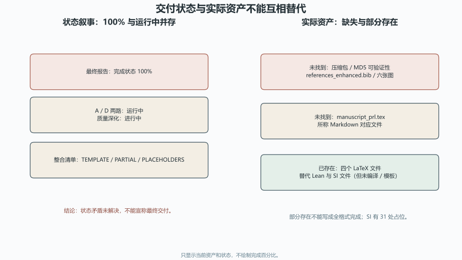

# 技术文档交付与验证：资产、状态和未竟工作审计

> 日期：2026-11-10。只审计，不修改原文，不重跑计算或实验。

## 一、血缘裁决与四个发展方向

五份文档属于同一研究纲领的进度、质量与交付叙事，不是五个独立新理论。

| 来源 ID | 只读路径 | SHA-256 |
|:--|:--|:--|
| `delivery_summary` | `toe-sylva-audit/papers/room_temp_sc/organized/10-技术文档/01-交付摘要.md` | `957e71d98c74e813bed8780614552b20b0802f0ec6c4c598e2f3a39d2c49cdfc` |
| `final_report` | `toe-sylva-audit/papers/room_temp_sc/organized/10-技术文档/02-最终报告.md` | `563b2fae7222a9ac9ccec3fac849b467e9ae46d571e99def0ef423a9f878e667` |
| `progress_report` | `toe-sylva-audit/papers/room_temp_sc/organized/10-技术文档/03-进度报告.md` | `a4ffcdc575a2d9f0ae21108b5679856ed022c827bdd549020dc1f3be59d524bb` |
| `quality_progress` | `toe-sylva-audit/papers/room_temp_sc/organized/10-技术文档/04-质量进展.md` | `0da15ed8122b1908bb8ce155956aebd55166330ca094982f81c6637624354d64` |
| `integration_checklist` | `toe-sylva-audit/papers/room_temp_sc/organized/10-技术文档/05-整合检查清单.md` | `1510c3bc360560a1b131c9352616cd28717691abee41ff3951231a65d26d2909` |
| `artifact_inventory` | `sources/artifact-inventory.json` | `9f2feddf7049e236a507f3e4eae62f0e441ecd21644d03c25933a73ce0f52c81` |
| `main_claims_review` | `main-claims/review.json` | `e9ac6ff0bc88f11b1c2c91ae61ce398a05fc077815803f48669b46536d6f2f45` |
| `validation_review` | `validation-materials/review.json` | `17eaa27d30df6849f752e3712d563ebe492ae394ea9c74b1b072ac0755acb491` |
| `methods_review` | `room-temp-methods/review.json` | `f30d15d8665644d11957166efaea95d59f7a742037dc697b737704cd15dc9e21` |
| `handbook_review` | `handbook-chapters/review.json` | `0394b996c271a6ca24b4692d7bd078b4c0fa8925eefde6df0347a478f298ac48` |

| 方向 | 已闭合的局部审计 | 未竟工作与下一步 |
|:--|:--|:--|
| `artifact_existence`：压缩包、哈希、图件、引用库、版本和实际路径的可验证资产清单 | 压缩包、图、引用库缺失与四个 LaTeX、替代 Lean／SI 的存在状态已固定。 | 最终压缩包、全部图件、完整引用库、全格式版本和 MD5 验证未闭合。**下一步：**以实际路径和哈希生成资产清单，交付前逐项验收，不接受口头完成。 |
| `status_evidence`：最终 100%、运行中、模板和占位状态的时间线与一致性治理 | 最终 100% 与 A／D 运行中、质量深化中和模板清单的矛盾已定位。 | 历史状态、当前状态和交付状态没有统一证据源。**下一步：**以任务状态机和实际验收记录替代静态完成叙事，保留时间戳。 |
| `scientific_validation`：公式、评分、Lean、SI、实验角色和证据等级验证 | H₃S 复算、评分缺口、Lean 未编译、SI 模板和实验角色已核清。 | 公式链、评分卡、Lean 构建、DFT 输入、声子谱和独立实验未闭合。**下一步：**先完成最小科学垂直切片，再恢复验证通过与可发表措辞。 |
| `delivery_governance`：把整合清单转化为带资产、命令、退出码和责任边界的验收任务 | TEMPLATE／PARTIAL／PLACEHOLDERS 与实际交付缺口已对应。 | 最终资产、全部质量检查、作者信息和投稿前审查未完成。**下一步：**按资产、脚本、验证、复核四列验收，失败项保持未完成。 |

## 二、状态矛盾与实际资产

最终报告写 **完成状态 100%**，但 A／D 两路仍运行中、质量深化仍进行中、整合清单仍为 `TEMPLATE／PARTIAL／PLACEHOLDERS`。这些状态不能直接合并为最终交付。

| 资产 | 当前结果 | 验收裁决 |
|:--|:--|:--|
| `room_temp_sc_paper_FINAL_v2.tar.gz` | 未找到；63KB 和 MD5 不可验证 | 资产未验证，重新生成后计算新哈希 |
| 六张图 | 未找到 | 不写可视化已完成 |
| `references_enhanced.bib` | 未找到 | 不写 99 条引用已齐备 |
| `manuscript_prl.tex` 与所称 Markdown 对应文件 | 未找到 | 多版本只部分存在，不写全格式完成 |
| 四个 LaTeX 文件 | 已存在 | 保留，但不自动等于科学验证 |
| 替代 Lean 与 SI 文件 | 已存在 | Lean 未编译；SI 有 31 处占位，仍是草案／模板 |

**图件插入顺序：图 1 位于资产清单表之后、结果解释之前。** 图中不把 100% 当成可验证完成度。

## 三、科学验证仍不闭合

| 项目 | 实际结果 | 不能升级为 |
|:--|:--|:--|
| H₃S 公式 | 复算约 161.081844 K，文中为 203 K | 不能写公式链或材料预测已验证 |
| 验证评分 | 没有公开可复算规则 | 不能把百分比当科学验证结果 |
| Lean | 未编译且存在证明债务 | 不能写机器证明完成或不会报错 |
| SI | 31 处占位；DFT 输入、声子谱、收敛日志未提供 | 不能写计算验证完成 |
| Song／PNAS | 直接 Meissner 和独立复现未确立；PNAS 是理论预测 | 不能写完美实验验证或投稿保证 |

交付日期 2025-04-19 早于所引 2025-10 突破，构成元数据时间矛盾，需核对版本血缘而不判造假。

## 四、分档勘误与验收任务

| 级别 | 已观察问题 | 建议动作 |
|:--|:--|:--|
| P0 | 最终 100% 与 A／D 运行中、质量深化中和模板清单并存。 | 改为状态矛盾未解决，按实际验收记录更新，不宣称完成。 |
| P0 | 声称的 63KB 压缩包当前未找到，MD5 不可验证。 | 标为资产未验证；重新生成后记录路径、大小和实际哈希，不沿用旧 MD5。 |
| P0 | 99 条引用库和六张图当前未找到。 | 标为缺失资产，补齐前不写引用和可视化已完成。 |
| P1 | PRL 和所称 Markdown 对应文件未找到，多版本只部分存在。 | 保留四个已存在 LaTeX 文件，其余版本列为未竟，不写全格式完成。 |
| P1 | 交付日期 2025-04-19 早于所引 2025-10 突破。 | 核对版本血缘和实际生成时间，只标元数据矛盾，不判造假。 |
| P0 | H₃S 公式复算约 161.081844 K 且评分无规则，B／C 路仍写完成。 | 科学验证保持未闭合，先修公式链和公开评分卡，再讨论完成度。 |
| P0 | Lean 未编译且 SI 有 31 处占位，仍写不会报错和验证完成。 | 保持草案与模板状态，清偿证明债务并补齐 DFT 输入、声子谱和日志。 |
| P0 | Song 与 PNAS 被写成完美实验验证，直接 Meissner 和独立复现未确立。 | 分开作者预印本、理论预测和独立复现，不写完美验证或可发表保证。 |

后续验收采用四列：资产路径与哈希、执行命令、退出码、复核边界。任何失败项保持未完成，直到真实资产和科学证据同时闭合。

## 五、验证范围与开放边界

| 边界 | 状态 |
|:--|:--|
| `tar_verified` | `false` |
| `figures_verified` | `false` |
| `references99_verified` | `false` |
| `scientific_validation` | `false` |
| `delivery_ready` | `false` |
| `full_repository_audit` | `false` |

本批使用十项冻结来源、实际资产清单和独立复核。命令与退出码见 `run.log`；Word 渲染状态见 `word-qa/report.json`。

本批没有重跑计算或实验，没有重建压缩包或图件，没有修改五份原文。**全库审计尚未完成。**
