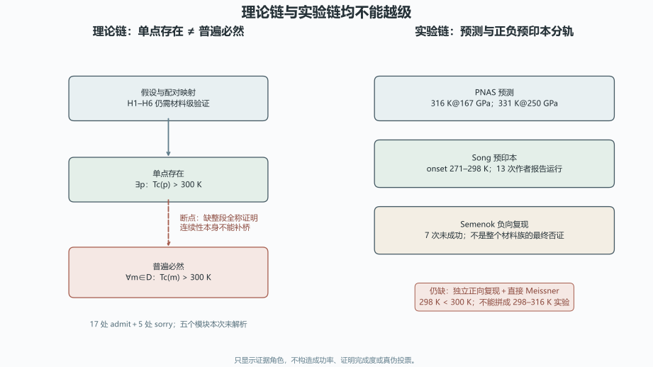

# 理论框架与突破详解：证明链、实验角色与未竟工作审计

> 日期：2026-11-10。只审计，不修改原文，不新增形式证明、材料预测或实验验证。

## 一、血缘裁决与四个发展方向

两份文档属于同一研究纲领的理论陈述与实验叙事，不是两个独立新理论。

| 来源 ID | 只读路径 | SHA-256 |
|:--|:--|:--|
| `theory_framework` | `toe-sylva-audit/papers/room_temp_sc/organized/03-理论框架/01-理论框架.md` | `c53b9b8fbab8018e3e2948e8ecff71d0232dd47e60c8a86f4281e58200c262fb` |
| `breakthrough_report` | `toe-sylva-audit/papers/room_temp_sc/organized/06-突破详解/01-2025年10月突破.md` | `7d9711df200880690a82c814380e4392f35a1ca3c6df957cabe6607678ba00ce` |
| `main_claims_review` | `research/paper-direction-audit-2026-11-10/main-claims/review.json` | `e9ac6ff0bc88f11b1c2c91ae61ce398a05fc077815803f48669b46536d6f2f45` |
| `methods_review` | `research/paper-direction-audit-2026-11-10/room-temp-methods/review.json` | `f30d15d8665644d11957166efaea95d59f7a742037dc697b737704cd15dc9e21` |

| 方向 | 已闭合的局部审计 | 未竟工作与下一步 |
|:--|:--|:--|
| `conditional_proof`：把普遍必然性收缩为明确假设下的条件化命题与证明工程 | 17 处 admit、5 处 sorry 和单点到全称的逻辑断点已定位。 | 命题类型、模块实现、假设充分性、全部证明体和真实构建未闭合。**下一步：**先固定最小可证命题与定义，再逐引理清偿并执行公理审计。 |
| `assumption_falsifiability`：把 H1–H6、适用域和竞争相转为可操作的可证伪检验 | H1–H5 不自动给出 Tc>300 K，单点存在和连续性不足以支持全称命题。 | 阈值一致性、模型适用域、竞争相排除和材料级测量接口仍缺失。**下一步：**为每个假设绑定可观测量、反例条件和失败后的理论降级规则。 |
| `experimental_controversy`：并列正向与负向预印本，推进前驱体、跨实验室和直接磁测量 | Song、Semenok 与 PNAS 的证据角色已分开，298 K 与预测 316/331 K 不再混写。 | 独立正向复现、直接 Meissner、同行评议、前驱体有序化和总尝试分母。**下一步：**保存双方原始数据，优先做可重复合成与直接磁测量的对照实验。 |
| `provenance_governance`：修复时间、预测／实验、作者运行／独立复现和证据等级口径 | 298/316 角色混合、P6/mmm 推准二维、13 次独立实验和日期矛盾已定位。 | 原文修订、版本血缘、引用同步和跨文档一致性尚未完成。**下一步：**建立带来源定位的证据卡，修订留痕并同步所有派生版本。 |

## 二、理论证明链：17 处 admit、5 处 sorry

理论文档有 **17 处 admit、5 处 sorry**，合计 22 处显式证明债务。五个 `Superconductivity.*` 模块引用及三个核心定理名在本次 `toe-sylva-audit/**/*.lean` 检索中未解析；扫描 28 个 Lean 文件。未解析不等于其他位置绝对不存在实现，本批也未运行 Lean 编译。

| 项目 | 审计结果 | 不能升级为 |
|:--|:--|:--|
| 显式证明债务 | 17 处 admit；5 处 sorry | 构造性证明已完成 |
| 模块解析 | 五个引用；本次仓库命中 0 | 已有可构建实现或其他位置不存在 |
| 单点存在到普遍必然 | 不是有效逻辑推论 | 连续性自动把所有材料变为室温超导 |
| 简化公式锚点 | λ=2.0、μ*=0.15、ωlog=100.0 meV 时 Tc≈148.243135 K | 否定完整 Eliashberg 或特定材料 |

形式化断点可写为：

$$(\exists p: T_c(p)>300\,K) \nRightarrow (\forall m\in D: T_c(m)>300\,K).$$

需要发展的不是更强的标题，而是最小可证命题、模块实现、充分条件和逐引理清偿。H1–H6 应绑定可观测量、反例条件和失败后的降级规则。

## 三、突破详解：实验与预测必须分轨

| 来源 | 数值与角色 | 尚未确立 |
|:--|:--|:--|
| PNAS 2024 | 167 GPa→316 K；250 GPa→331 K；理论预测 | 不能作为后续实验值 |
| Song 2025 预印本 | onset 271–298 K；13 次作者报告可重复运行 | 独立正向复现、直接 Meissner、同行评议、总尝试分母 |
| Semenok 2026 预印本 | 7 次未成功；独立负向复现 | 不是对 Song 或整个材料族的最终逻辑否证 |

**图件插入顺序：图 1 位于证据角色表之后、结果解释之前。** 图中没有成功率或证明完成百分比。

**298 K 低于 300 K。** 不能把 Song 的 298 K 与 PNAS 的 316 K 拼成 298–316 K 实验结果，更不能由单个材料报告证明所有满足抽象假设的材料必然室温超导。

13 次作者报告的可重复运行不等于 13 个独立实验室；`P6/mmm` 不自动证明准二维，结构与 Tc 一致也不单独验证微观配对机制。

突破文档日期为 2025-04-19，却引用 2025-10 预印本，构成元数据时间矛盾。下一步应核查版本血缘，不直接判定造假。

## 四、分档勘误与发展任务

| 级别 | 已观察问题 | 建议动作 |
|:--|:--|:--|
| P0 | 构造性存在证明措辞与 17 处 admit、5 处 sorry 并存。 | 保持草案和条件化命题身份；不得以占位可解析宣称机器证明完成。 |
| P0 | 单点 Tc>300 K 存在性被用于所有满足假设材料的普遍必然性。 | 补齐从存在点到全称命题的充分条件与证明；连续性本身不构成该桥梁。 |
| P0 | 298 K 实验 onset 与 316 K 理论预测被拼成 298–316 K，并用于完美验证必然性。 | 分开实验与预测；298 K 低于 300 K，且单个材料不能证明全称数学命题。 |
| P1 | 13 次作者报告运行被写成 13 次独立实验。 | 改为 13 次可重复运行；独立实验室与总尝试分母仍待提供。 |
| P1 | P6/mmm 被直接等同准二维，结构与 Tc 一致被用于验证微观机制。 | 分别提供层状各向异性、谱函数、同位素和配对机制证据，不由空间群自动推出。 |
| P1 | 文档生成日期 2025-04-19 早于所引 2025-10 预印本。 | 核对版本血缘和实际生成时间；只标元数据矛盾，不判造假。 |

四个方向都值得继续，但它们是同一研究纲领的方法任务，不是四个已经成立的新理论。优先级应是：先收缩命题并建立最小证明核，再做假设—测量接口与争议实验对照，最后同步全部派生文档。

## 五、验证范围与开放边界

| 边界 | 状态 |
|:--|:--|
| `formal_proof_completed` | `false` |
| `lean_modules_resolved` | `false` |
| `necessity_experimentally_proven` | `false` |
| `independent_positive_replication` | `false` |
| `direct_meissner_completed` | `false` |
| `full_repository_audit` | `false` |

本批使用冻结哈希、原文独立文本扫描、既有原始来源审计和独立数值复算。命令与退出码见 `run.log`；Word 逐页结果见 `word-qa/report.json`。

本批没有运行 Lean、没有新做 DFT/Eliashberg、没有新做实验或独立复现、没有修改两份原文。**全库审计尚未完成。**
