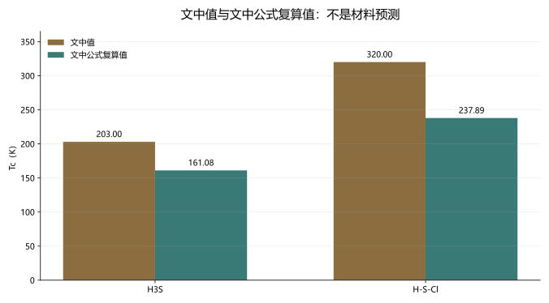

# 实验验证与材料预测：证据角色、公式链与未竟工作审计

> 日期：2026-11-10。只审计，不修改原文，不新增材料预测，不把文内公式复算称为第一性原理结果。

## 一、血缘裁决与四个问题族

两份文档属于同一研究纲领的验证与预测环节，不是两个新理论。审计分为公式链、样品与掺杂、高阶氢化物、验证治理四个方法问题族。

| 来源 ID | 只读路径 | SHA-256 |
|:--|:--|:--|
| `validation_report` | `toe-sylva-audit/papers/room_temp_sc/organized/05-实验验证/01-实验验证.md` | `51a4709522000dca521dcecd071f20766763821eca94cb9e279335ea91f47e90` |
| `material_predictions` | `toe-sylva-audit/papers/room_temp_sc/organized/04-材料预测/01-材料预测.md` | `050b52aa56bb633fd1db95e198f9804085de26080f4b18f135f44e3c8ef326ef` |
| `numeric_spotcheck` | `validation-materials/numeric_spotcheck.py` | `c11de34cb4f238e9c837effb735ebc9629921ea9494af28d474d75fddcee95d9` |
| `primary_excerpts` | `validation-materials/sources/primary-source-excerpts.md` | `62cf61470cc7be0d17ee5e53a7e9f01b8cf8013c009698526aeafdcf5c281528` |

| 问题族 | 已闭合的局部审计 | 未竟工作与下一步 |
|:--|:--|:--|
| `formula_evidence`：文内公式、参数、单位和修正因子的可复核证据链 | 两组表内参数与结果不一致已由独立脚本复算。 | f1/f2、ω2/ωlog、参数来源、压力和掺杂结构未闭合。**下一步：**补齐推导与原始输入输出，不以复算值替代预测。 |
| `sample_doping`：化学式、掺杂范围与样品证据角色审计 | 未掺杂 LaNiO₂ 绝缘与 Ca 掺杂超导穹顶已分清。 | 不同掺杂、应变、薄膜厚度和输运证据仍需逐项对应。**下一步：**每条材料结论绑定化学式、掺杂、形态和原始图号。 |
| `higher_order_hydride`：高阶／取代氢化物的实验争议与独立验证 | 556 K 原文存在，但其不可逆高阶角色与二元 LaH₁₀ 不同。 | 独立复现、成分相确定、Meissner、热力学平衡和原始数据。**下一步：**把高阶实验宣称与二元材料常规验证分轨。 |
| `validation_governance`：验证评分、研发排序与证据治理 | 百分比和星级缺少可复算规则，已降为治理标签。 | 评分卡、权重、样本集、误差模型和独立复核未建立。**下一步：**若保留评分，公开可复算规则与不确定性。 |

## 二、公式链：文中值与文中公式复算值

文中简化公式为：

$$T_c=\frac{\omega_{\log}}{1.2}\exp(E),\qquad E=-\frac{1.04(1+\lambda)}{\lambda-\mu^*(1+0.62\lambda)}.$$

| 条目 | ωlog（K） | λ | μ* | 文中 Tc（K） | 文中公式复算（K） |
|:--|--:|--:|--:|--:|--:|
| H₃S | 1200 | 2 | 0.13 | 203 | 161.081843791778823 |
| H-S-Cl | 1500 | 2.5 | 0.12 | 320 | 237.894818964651591 |

**图件插入顺序：图 1 位于公式复算表之后、结果解释之前。** 图 1 是文内算术检查，不是材料预测图。

复算只证明“参数—公式—结果不一致”，不能替代 Allen–Dynes 修正、Eliashberg 求解或第一性原理计算。必须补齐 f1/f2、ω2/ωlog、参数来源、压力、掺杂结构和原始输入输出。

独立第一性原理研究还给出：200 GPa 下 6.25% Cl→161 K、12.5% Cl→136 K。Cl 掺杂削弱超导但降低稳定压力，与 20% Cl→320 K 的提升推断不相容。[原始来源](https://arxiv.org/html/1804.08224v3)。

## 三、LaNiO₂：未掺杂薄膜绝缘，掺杂后才讨论超导

原文摘要明确：未掺杂和低掺杂 La1−xCaxNiO2 薄膜从 300 K 到 2 K 均绝缘，超导穹顶位于 `0.15 < x < 0.3`。因此**未掺杂薄膜绝缘**，不能把 LaNiO₂ 写成 20–40 K 已验证超导体。[PMC 原始全文](https://pmc.ncbi.nlm.nih.gov/articles/PMC8856608/)。

后续每个材料结论必须绑定化学式、掺杂元素、掺杂范围、薄膜形态、输运证据和原始图号；不能将掺杂样品的结论继承给未掺杂母体。

## 四、556 K：真实论文，但不是二元 LaH₁₀ 的常规验证

Grockowiak 等原文报告初始 294 K，后续热循环使 onset 不可逆达到 556 K。原文描述扭曲 LaH₁₀ 骨架及取代形成高阶化合物，并明确缺少 Meissner 和可靠高温 H–T 相图，还存在非零电阻和混合相。[Frontiers 原始全文](https://www.frontiersin.org/journals/electronic-materials/articles/10.3389/femat.2022.837651/full)。

因此这篇论文不能被删除或称为虚构，但也不能并入二元 LaH₁₀ 的常规验证百分比。后续需要独立复现、成分与相确定、直接磁测量、热力学平衡和原始样品路径核对。

## 五、验证百分比与星级：治理标签，不是定量结果

无复算规则的研究治理标签，不是定量科学验证结果。92%、88%、45%、9.5/10 和星级没有公开指标定义、权重、样本集、误差模型或复算公式。若保留，只能标为主观研究治理标签；建立公开评分卡后才可以量化。

## 六、分档勘误与未竟工作

| 级别 | 已观察问题 | 建议动作 |
|:--|:--|:--|
| P0 | 表内参数—公式—Tc 结果不一致，且 Cl 第一性原理方向与 320 K 推断相反。 | 标为推导链未闭合，补齐修正因子和参数来源，禁止直接替换为复算值。 |
| P0 | 未掺杂 LaNiO₂ 被写成 20–40 K 已验证超导体。 | 改为未掺杂薄膜绝缘，超导只用于明确掺杂的 La1−xCaxNiO2 范围。 |
| P0 | 556 K 被并入二元 LaH₁₀ 的常规验证叙事。 | 保留真实论文，改为不可逆高阶／取代氢化物的待独立验证证据。 |
| P1 | 验证百分比和星级没有公开计算规则。 | 删除定量验证口吻或改为主观治理标签，建立评分卡后再量化。 |

真正的未竟工作不是再写一组更高 Tc，而是建立原始输入、参数、修正因子、样品身份、独立复现和可复算评分卡之间的闭环。

## 七、验证范围

本批使用冻结哈希、原始出版商/PMC/arXiv 来源和独立公式复算。命令、退出码见 `run.log`；Word 逐页结果见 `word-qa/report.json`。

本批没有重跑第一性原理、没有替换材料预测、没有新做实验或独立复现、没有修改两份原文。**全库审计尚未完成。**
